# OPUS — Operative Photo Unite and Storage


**Clinical photography and research records for surgeons, organised by patient, procedure and surgical stage.**

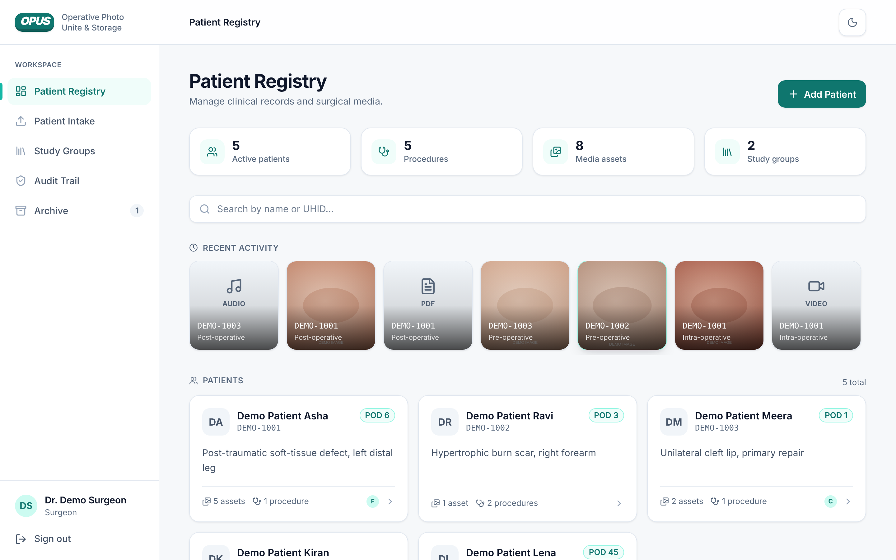

---

## Contents

- [Overview](#overview)
- [Screenshots](#screenshots)
- [Features](#features)
- [Tech stack](#tech-stack)
- [Architecture](#architecture)
- [Project structure](#project-structure)
- [Getting started](#getting-started)
- [Configuration](#configuration)
- [Running the app](#running-the-app)
- [Usage walkthrough](#usage-walkthrough)
- [Scripts](#scripts)
- [Data API reference](#data-api-reference)
- [Design system and accessibility](#design-system-and-accessibility)
- [Testing](#testing)
- [Linting and formatting](#linting-and-formatting)
- [Deployment](#deployment)
- [Security model](#security-model)
- [Database migrations](#database-migrations)
- [Troubleshooting and FAQ](#troubleshooting-and-faq)
- [Known limitations](#known-limitations)
- [Roadmap ideas](#roadmap-ideas)
- [Contributing](#contributing)
- [License](#license)

---

## Overview

Surgeons and clinical researchers take a lot of photographs, videos and voice memos before, during and after operations. These files often end up on personal phones, mixed with everything else, with no reliable link to the patient, the procedure or the post-operative day. That makes follow-up comparisons, case presentations and research cohorts slow and risky.

OPUS gives each clinician a private workspace where:

- every file is attached to a **patient** (by hospital ID / UHID), a **procedure** and a **surgical stage** (pre-, intra- or post-operative);
- the **post-operative day (POD)** is worked out automatically;
- patients can be grouped into **study groups** for research;
- every change is written to an **append-only audit trail**.

**Who it is for:** surgeons, surgical fellows and clinical researchers who need a simple, phone-friendly way to capture and find clinical media. It runs in any modern browser, on desktop and on phones.

**How it works:** OPUS is a single-page React app that talks directly to a [Supabase](https://supabase.com) project. Postgres row-level security (RLS) keeps each user's records isolated, and media files live in a private storage bucket that is only reachable through short-lived signed URLs. There is no custom backend server to run.

## Screenshots

All screenshots were captured from the production build running in headless Chromium, with a mocked Supabase API serving **fictional demo data**. "Demo Patient …" records and the placeholder "DEMO IMAGE" pictures are not real patients or clinical photos.

| Patient record                                         | Patient intake                                   |
| ------------------------------------------------------ | ------------------------------------------------ |
| 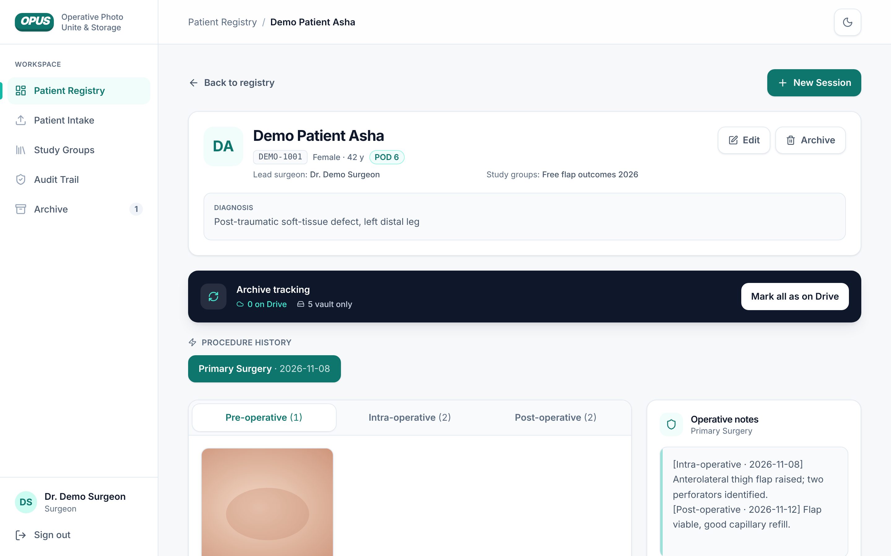 | 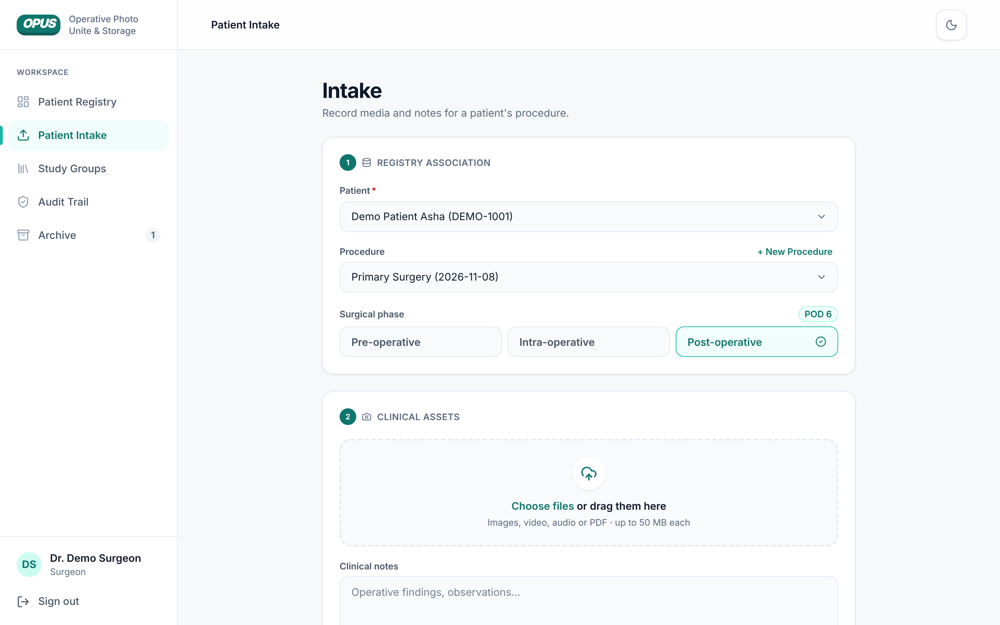           |
| **Study group**                                        | **Audit trail**                                  |
| 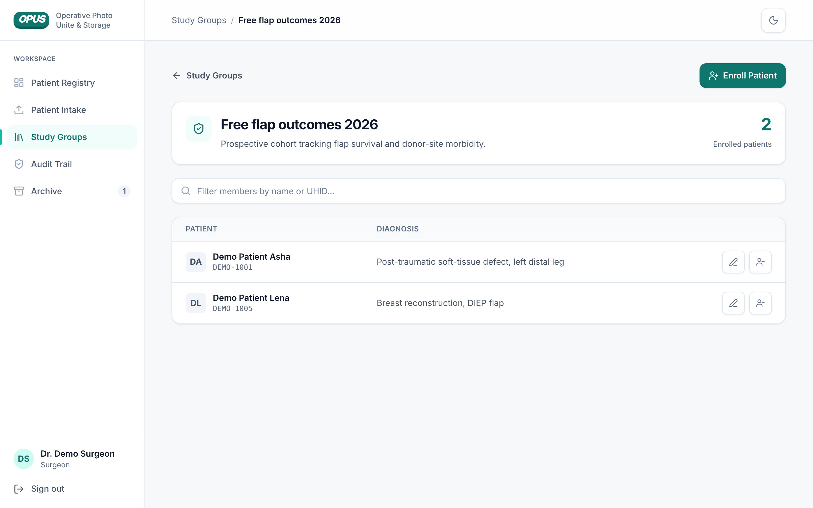       | 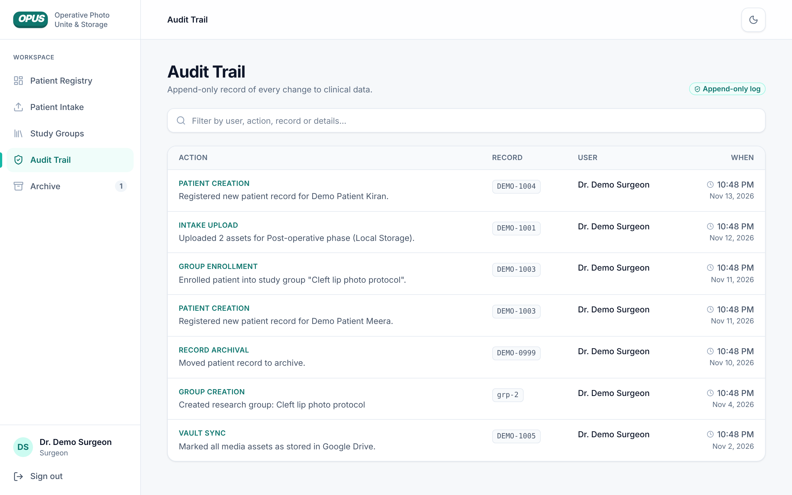 |
| **Archive**                                            | **Sign in**                                      |
| 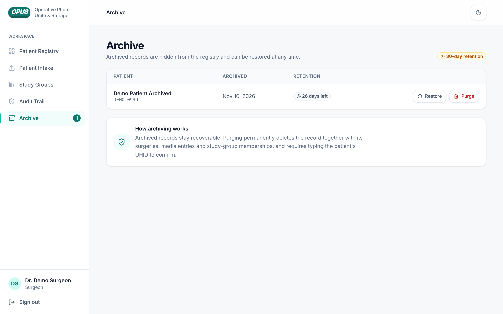               | 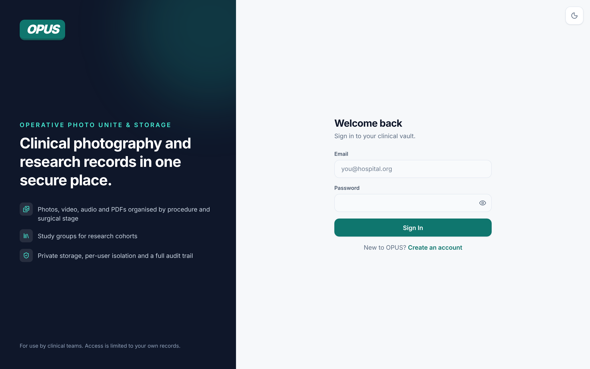         |

**Dark theme** (follows the operating system until you pick one with the moon/sun button):

| Dashboard (dark)                                              | Patient record (dark)                                                   |
| ------------------------------------------------------------- | ----------------------------------------------------------------------- |
| 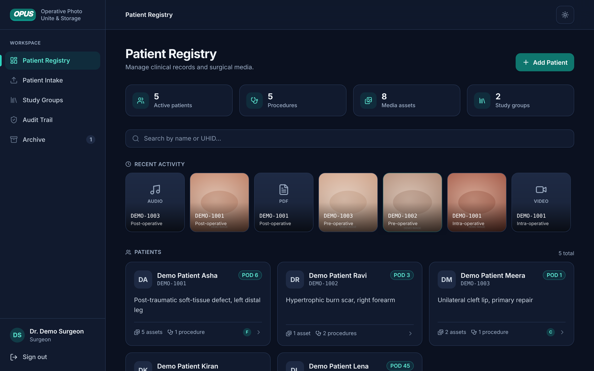 | 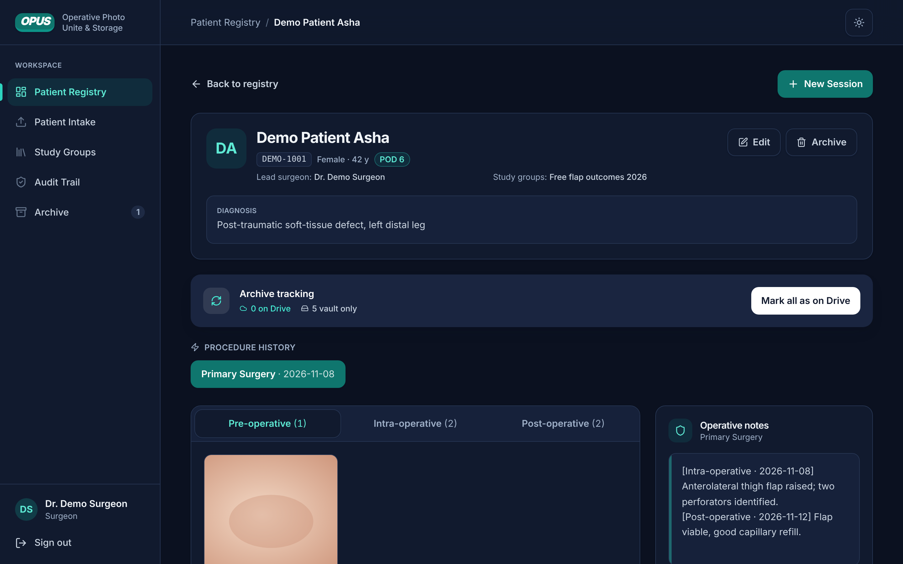 |

**Phones** (bottom navigation dock, bottom-sheet dialogs, 44 px touch targets):

| Registry                                                                                | Patient record                                                                              | Intake (dark)                                                                                       |
| --------------------------------------------------------------------------------------- | ------------------------------------------------------------------------------------------- | --------------------------------------------------------------------------------------------------- |
| 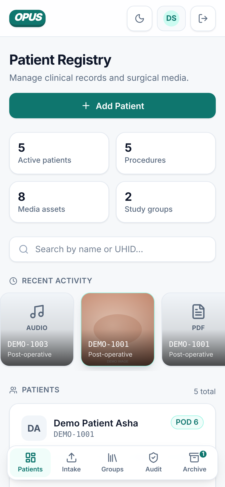 | 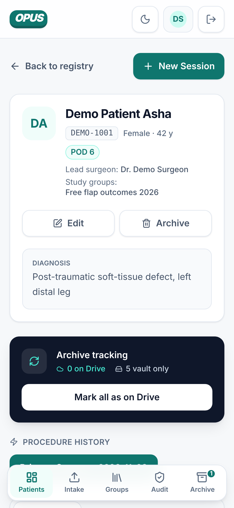 | 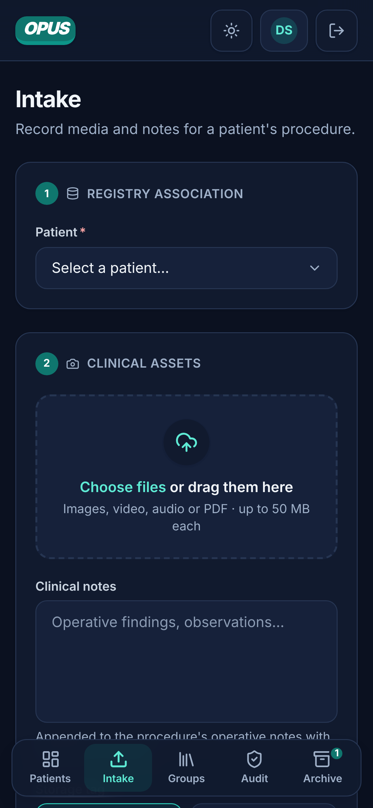 |

**Form validation** shows a message next to each field instead of failing silently:

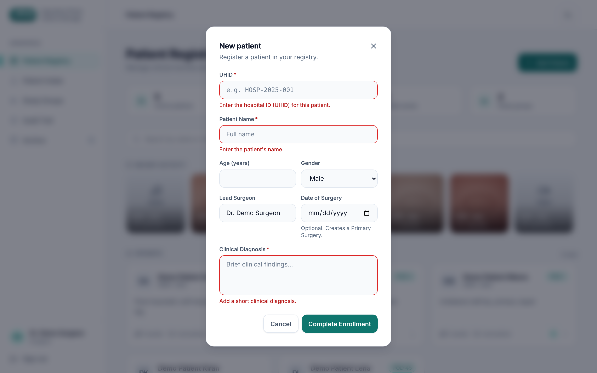

## Features

**Patient registry**

- Register patients with UHID, name, age, gender, lead surgeon, diagnosis and an optional surgery date. A surgery date creates a "Primary Surgery" procedure automatically.
- Summary tiles: active patients, procedures, media assets and study groups.
- Instant search by name or UHID, with a result count and a "clear search" shortcut.
- Patient cards show the POD badge, diagnosis, asset and procedure counts, and study-group membership.
- Recent activity strip with the latest uploads and notes.

**Patient record**

- Header with demographics, lead surgeon, study groups and diagnosis; edit and archive actions.
- Procedure history tabs and a gallery filtered by surgical stage, with per-stage counts.
- Full-screen viewer for images, video, audio and PDFs (inline), with open/download links.
- Operative notes for the selected procedure.
- Archive tracking: tag media as "Local Vault" or "Google Drive" to record where copies were archived. This is metadata only; OPUS does not connect to Google Drive.

**Intake (new session)**

- Two-step form: choose the patient, procedure (or create a new one) and phase, then add files and notes.
- Upload images, video, audio and PDFs up to 50 MB each, with a preview queue and per-file removal.
- POD shown live when the post-operative phase is selected.
- Notes are appended to the procedure's operative log with the phase and date.
- If a later step fails, files that were already uploaded are removed again.

**Research and governance**

- Study groups: create and edit cohorts, enrol and remove patients, filter members.
- Archive: soft-delete with a 30-day retention countdown, restore, or permanently delete (you must type the UHID to confirm).
- Audit trail: every create, update, upload, archive, restore, purge and enrolment is logged with the user and time. The log is searchable and cannot be edited or deleted through the API.

**Experience**

- Light and dark themes, applied before first paint (no flash), with the choice remembered per device.
- Responsive layout: sidebar on desktop, bottom dock on phones and tablets in portrait.
- Loading, empty, error (with retry) and success states on every data screen.
- Keyboard accessible: skip link, visible focus ring, focus-trapped dialogs that close with Escape and return focus.
- A setup screen instead of a blank page when Supabase isn't configured.

## Tech stack

| Layer   | Technology                                                                 |
| ------- | -------------------------------------------------------------------------- |
| UI      | React 19, TypeScript 5.8 (strict), Tailwind CSS 4, lucide-react icons      |
| Build   | Vite 6 (code-split views; separate React and supabase-js vendor chunks)    |
| Backend | Supabase: Postgres with row-level security, Auth (email/password), Storage |
| Quality | ESLint 9 (typescript-eslint, react-hooks), Prettier 3                      |
| Tests   | Vitest 5, Testing Library, jsdom; optional live-Supabase integration suite |
| CI      | GitHub Actions (`.github/workflows/ci.yml`)                                |
| Font    | Inter (Google Fonts)                                                       |

## Architecture

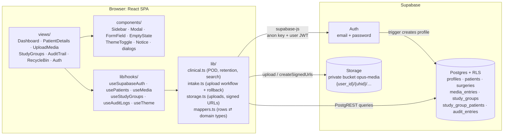

How the pieces fit:

- **No custom server.** The browser talks to Supabase with the public anon key and the signed-in user's JWT. All authorisation is enforced in Postgres by RLS policies, not in client code.
- **Data hooks** (`src/lib/hooks/`) fetch and mutate one resource each, surface errors as strings, and refetch after every change.
- **Domain logic is pure** (`src/lib/clinical.ts`, `src/lib/intake.ts`), so it can be unit tested without a backend. The intake workflow takes its dependencies as arguments.
- **Media URLs:** rows store the storage object key. When media loads, the keys are exchanged for one-hour signed URLs in a single batch request. Rows from older versions that stored a public URL still work, because the key is parsed out of the URL.
- **Navigation** is held in React state (no URL router). The document title follows the visible screen.

### Intake sequence

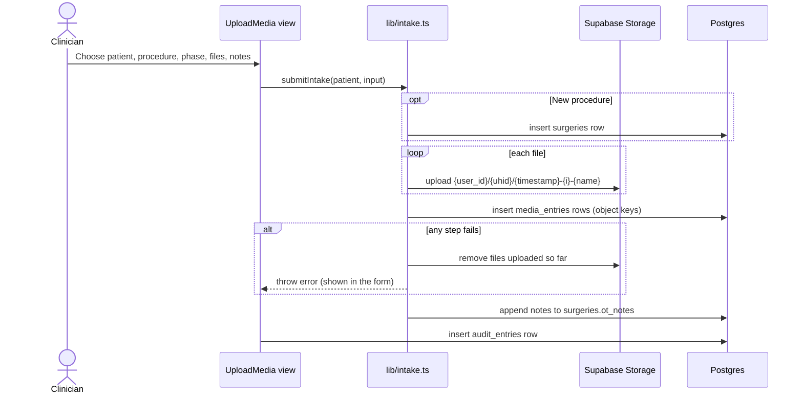

## Project structure

```
.
├── index.html                    # HTML shell: meta/OG tags, favicon, no-flash theme script
├── public/
│   ├── favicon.svg               # App icon
│   └── og-image.png              # Link-preview image (screenshot of the dashboard with demo data)
├── src/
│   ├── main.tsx                  # Entry point
│   ├── App.tsx                   # Config gate → auth gate → workspace (layout, header, view state, dialogs)
│   ├── index.css                 # Design tokens (light + dark), shared utilities (btn, field, card…)
│   ├── types.ts                  # Domain types (Patient, MediaEntry, StudyGroup, …)
│   ├── components/
│   │   ├── Sidebar.tsx           # Desktop sidebar + mobile bottom dock
│   │   ├── Modal.tsx             # Portalled, focus-trapping dialog (bottom sheet on phones)
│   │   ├── FormField.tsx         # Label + control + hint/error, wired with aria attributes
│   │   ├── EmptyState.tsx        # Placeholder with icon, text and an optional action
│   │   ├── ThemeToggle.tsx       # Light/dark switch
│   │   ├── Notice.tsx            # Toast for success/error results
│   │   ├── Spinner.tsx           # Loading indicator announced to screen readers
│   │   ├── ConfirmActionModal.tsx# Archive / restore / permanent-delete confirmation
│   │   ├── PatientEditModal.tsx  # Edit patient details
│   │   ├── StudyGroupModal.tsx   # Create / edit a study group
│   │   ├── Logo.tsx              # OPUS wordmark
│   │   └── navigation.ts         # View ids and titles
│   ├── views/                    # One lazy-loaded component per screen
│   │   ├── AuthScreen.tsx        # Sign in / create account
│   │   ├── SetupScreen.tsx       # Shown when env vars are missing
│   │   ├── Dashboard.tsx         # Registry, search, summary, new-patient form
│   │   ├── PatientDetails.tsx    # Patient record, gallery, viewer, notes
│   │   ├── UploadMedia.tsx       # Intake form
│   │   ├── StudyGroupsView.tsx   # Study group list
│   │   ├── StudyGroupDetailView.tsx # Members, enrol/remove
│   │   ├── AuditTrail.tsx        # Searchable audit log
│   │   └── RecycleBin.tsx        # Archive
│   └── lib/
│       ├── clinical.ts           # Pure helpers: dates, POD, retention, MIME, paths, search, initials
│       ├── intake.ts             # Intake workflow with rollback (dependency-injected)
│       ├── storage.ts            # Uploads and batch signed URLs
│       ├── surgeries.ts          # Surgery inserts and note appends
│       ├── mappers.ts            # Postgres rows ⇄ domain types
│       ├── patientDraft.ts       # New-patient form model and validation
│       ├── theme.ts              # Theme resolution and persistence
│       ├── env.ts / supabase.ts  # Configuration and the shared client
│       └── hooks/                # useSupabaseAuth, usePatients, useMedia, useStudyGroups,
│                                 # useAuditLogs, useTheme, useDocumentTitle
├── supabase/migrations/          # Versioned SQL: schema, RLS, storage bucket and policies
├── tests/
│   ├── unit/                     # Vitest unit and component tests (no backend needed)
│   └── integration/              # Live Supabase suite (deep-test.mjs) and its env loader
├── docs/screenshots/             # Images used in this README
├── .github/workflows/ci.yml      # Format, lint, type-check, test, build
├── eslint.config.js · .prettierrc.json · tsconfig.json · vite.config.ts · vitest.config.ts
└── .env.example                  # Template for the two required variables
```

## Getting started

### Prerequisites

| Tool                                                 | Version                  | Needed for                                            |
| ---------------------------------------------------- | ------------------------ | ----------------------------------------------------- |
| [Node.js](https://nodejs.org)                        | 20 or newer (CI uses 22) | Install, dev server, build, tests                     |
| npm                                                  | Comes with Node          | Package management (`package-lock.json` is committed) |
| A [Supabase](https://supabase.com) project           | Free tier is fine        | Database, auth and file storage                       |
| [Supabase CLI](https://supabase.com/docs/guides/cli) | Recent                   | Applying the SQL migrations                           |

### 1. Clone and install

```bash
git clone https://github.com/jeevithg090/Opus-App.git
cd Opus-App
npm install        # or `npm ci` for a clean, lockfile-exact install
```

### 2. Create the Supabase project

1. Create a project at <https://supabase.com/dashboard>.
2. Under **Project Settings → API**, copy the **Project URL** and the **anon / public** key.
3. Under **Authentication → Providers**, make sure **Email** is enabled. If you keep "Confirm email" on, new users must click the link in their email before they can sign in.

### 3. Configure environment variables

```bash
cp .env.example .env
# then edit .env and paste your values
```

See [Configuration](#configuration) for details.

### 4. Apply the database migrations

```bash
supabase login
supabase link --project-ref <your-project-ref>
supabase db push
```

This creates the tables, the profile trigger, all RLS policies and the private `opus-media` storage bucket. Prefer not to use the CLI? Paste each file from `supabase/migrations/` into the dashboard's **SQL Editor**, in filename order.

### 5. Start the dev server

```bash
npm run dev
```

Open <http://localhost:3000>, choose **Create an account**, then sign in.

## Configuration

OPUS reads two variables at build time. Vite only exposes variables prefixed with `VITE_` to the browser.

| Variable                 | Required | Default | Description                                                                             |
| ------------------------ | -------- | ------- | --------------------------------------------------------------------------------------- |
| `VITE_SUPABASE_URL`      | Yes      | none    | Your project URL, e.g. `https://abcd1234.supabase.co` (Project Settings → API).         |
| `VITE_SUPABASE_ANON_KEY` | Yes      | none    | The **anon / public** API key. It is safe in the browser because RLS protects the data. |

> [!WARNING]
> Never put the **service-role** key in a `VITE_` variable. Everything with that prefix is embedded in the JavaScript bundle that every visitor downloads.

If either variable is missing, the app shows a **Configuration required** screen instead of failing. Vite also reads `.env.local`, `.env.production` and so on. All of them except `.env.example` are git-ignored.

Other settings live in code:

| Setting                      | Where                                                   | Value                                                  |
| ---------------------------- | ------------------------------------------------------- | ------------------------------------------------------ |
| Dev server port / host       | `vite.config.ts`                                        | `3000`, `0.0.0.0` (reachable from a phone on your LAN) |
| Preview server port          | `vite.config.ts`                                        | `4173`                                                 |
| Max upload size              | `src/views/UploadMedia.tsx`, bucket limit in migrations | 50 MB per file                                         |
| Signed URL lifetime          | `src/lib/storage.ts`                                    | 1 hour                                                 |
| Archive retention countdown  | `src/lib/clinical.ts`                                   | 30 days                                                |
| Theme preference storage key | `src/lib/theme.ts`                                      | `opus-theme` in `localStorage`                         |

## Running the app

| Mode              | Command           | Notes                                                       |
| ----------------- | ----------------- | ----------------------------------------------------------- |
| Development       | `npm run dev`     | Hot reload at <http://localhost:3000>, also on your LAN IP. |
| Production build  | `npm run build`   | Type-checks, then writes static files to `dist/`.           |
| Preview the build | `npm run preview` | Serves `dist/` at <http://localhost:4173>.                  |

The production build is plain static files (HTML, JS, CSS, images). See [Deployment](#deployment).

## Usage walkthrough

1. **Create an account and sign in.** Pick your role (Surgeon, Fellow or Researcher). A profile row is created for you automatically.
2. **Register a patient.** On **Patient Registry**, select **Add Patient**. UHID, name and diagnosis are required. Add a surgery date to create a "Primary Surgery" right away. Missing or invalid fields are highlighted with a message.
3. **Record a session.** Open **Patient Intake** (or **New Session** on a patient record):
   - choose the patient, then an existing procedure or **+ New Procedure** (title and date);
   - pick the phase (pre-, intra- or post-operative; the POD appears for post-op);
   - choose files or drag them onto the drop zone, add clinical notes, and choose a storage tag;
   - select **Save Session**. You'll see a confirmation with shortcuts to start another session or go back.
4. **Review the record.** Select a patient card. Switch procedures and stages, open any asset full screen, download originals, and read the operative notes.
5. **Build a cohort.** In **Study Groups**, select **Create Group**, open it, then **Enroll Patient**.
6. **Archive and restore.** Use **Archive** on a patient record. Restore it from **Archive**, or purge it permanently by typing its UHID.
7. **Check the audit trail.** **Audit Trail** lists every action. Filter by user, action, record or details.
8. **Switch theme.** Use the moon/sun button in the header (or on the sign-in page).

## Scripts

| Command                    | What it does                                                                |
| -------------------------- | --------------------------------------------------------------------------- |
| `npm run dev`              | Start the Vite dev server on port 3000                                      |
| `npm run build`            | `tsc --noEmit`, then a production build into `dist/`                        |
| `npm run preview`          | Serve the production build on port 4173                                     |
| `npm run typecheck`        | TypeScript type-check only                                                  |
| `npm run lint`             | ESLint over the whole repo                                                  |
| `npm run format`           | Format everything with Prettier                                             |
| `npm run format:check`     | Check formatting without writing (used in CI)                               |
| `npm test`                 | Run unit and component tests once (Vitest)                                  |
| `npm run test:watch`       | Vitest in watch mode                                                        |
| `npm run test:coverage`    | Unit tests with a V8 coverage report for `src/lib` (excluding hooks)        |
| `npm run test:integration` | Live suite against the Supabase project in `.env` (see [Testing](#testing)) |

## Data API reference

OPUS has no server of its own. It uses Supabase's auto-generated REST (PostgREST), Auth and Storage APIs through `supabase-js`. Every request carries the anon key, and every data request also carries the user's JWT. RLS limits rows to the caller's own data.

The calls the app makes:

| Method        | Path                                                                                                           | Auth     | Used for                                                                   |
| ------------- | -------------------------------------------------------------------------------------------------------------- | -------- | -------------------------------------------------------------------------- |
| POST          | `/auth/v1/signup`                                                                                              | anon key | Create an account (`name`, `role` in user metadata)                        |
| POST          | `/auth/v1/token?grant_type=password`                                                                           | anon key | Sign in                                                                    |
| POST          | `/auth/v1/logout`                                                                                              | user JWT | Sign out                                                                   |
| GET           | `/rest/v1/profiles?id=eq.{uid}`                                                                                | user JWT | Load the signed-in user's profile                                          |
| GET           | `/rest/v1/patients?select=*,surgeries(*),study_groups:study_group_patients(study_group_id)&deleted_at=is.null` | user JWT | Active patients with procedures and group membership                       |
| GET           | `/rest/v1/patients?…&deleted_at=not.is.null`                                                                   | user JWT | Archived patients                                                          |
| POST          | `/rest/v1/patients`                                                                                            | user JWT | Register a patient (duplicate UHID → `23505`, shown as a friendly message) |
| PATCH         | `/rest/v1/patients?uhid=eq.{uhid}`                                                                             | user JWT | Edit details, archive (`deleted_at`), restore                              |
| DELETE        | `/rest/v1/patients?uhid=eq.{uhid}`                                                                             | user JWT | Permanent delete (cascades to surgeries, media rows, memberships)          |
| POST          | `/rest/v1/surgeries`                                                                                           | user JWT | New procedure                                                              |
| PATCH         | `/rest/v1/surgeries?id=eq.{id}`                                                                                | user JWT | Append operative notes                                                     |
| GET           | `/rest/v1/media_entries?order=uploaded_at.desc`                                                                | user JWT | All media rows                                                             |
| POST          | `/rest/v1/media_entries`                                                                                       | user JWT | Record uploaded files                                                      |
| PATCH         | `/rest/v1/media_entries?patient_uhid=eq.{uhid}`                                                                | user JWT | Change the storage tag for a patient's media                               |
| GET           | `/rest/v1/study_groups?select=*,patient_count:study_group_patients(count)`                                     | user JWT | Groups with member counts                                                  |
| POST / PATCH  | `/rest/v1/study_groups`                                                                                        | user JWT | Create / edit a group                                                      |
| POST / DELETE | `/rest/v1/study_group_patients`                                                                                | user JWT | Enrol / remove a patient                                                   |
| GET           | `/rest/v1/audit_entries?order=timestamp.desc&limit=500`                                                        | user JWT | Audit log (latest 500)                                                     |
| POST          | `/rest/v1/audit_entries`                                                                                       | user JWT | Append an audit entry (no update or delete policy exists)                  |
| POST          | `/storage/v1/object/opus-media/{user_id}/{uhid}/{file}`                                                        | user JWT | Upload a file (own folder only)                                            |
| POST          | `/storage/v1/object/sign/opus-media`                                                                           | user JWT | Batch-create one-hour signed URLs                                          |
| DELETE        | `/storage/v1/object/opus-media`                                                                                | user JWT | Remove files after a failed intake                                         |

Example: registering a patient, as sent by `supabase-js`:

```http
POST /rest/v1/patients HTTP/1.1
Host: <project-ref>.supabase.co
apikey: <anon key>
Authorization: Bearer <user access token>
Content-Type: application/json

{
  "uhid": "HOSP-2026-001",
  "name": "Jane Doe",
  "age_years": 42,
  "gender": "Female",
  "diagnosis": "Soft-tissue defect, left distal leg",
  "primary_surgeon": "Dr. Smith",
  "date_of_surgery": "2026-11-08",
  "created_at": "2026-11-14T09:30:00.000Z"
}
```

Response: `201 Created`. If the UHID already exists, PostgREST returns `409` with code `23505`, which the form shows as _A patient with UHID "HOSP-2026-001" already exists._

## Design system and accessibility

The UI is built on a small set of tokens and utilities in `src/index.css`:

| Token group | Names                                                                           | Purpose                                                    |
| ----------- | ------------------------------------------------------------------------------- | ---------------------------------------------------------- |
| Surfaces    | `canvas`, `surface`, `surface-2`, `surface-3`, `line`, `line-strong`            | Page, cards, inputs, borders                               |
| Text        | `ink`, `ink-2`, `ink-3`, `ink-4`                                                | Primary → muted text; `ink-4` is for decorative icons only |
| Brand       | `brand`, `brand-hover`, `brand-soft`, `brand-ink`, `brand-line`, `brand-accent` | Teal actions, highlights and focus ring                    |
| Status      | `danger-*`, `warn-*`                                                            | Destructive actions, errors and warnings                   |
| Inverse     | `inverse`, `inverse-2`                                                          | Always-dark panels                                         |

Shared utilities: `btn-primary`, `btn-secondary`, `btn-ghost`, `btn-danger`, `btn-icon`, `field`, `field-label`, `field-hint`, `field-error`, `card`, `eyebrow`, `page-title`, `page-subtitle`, `badge-brand`, `alert-error`, `alert-success`. Every token is redefined under `[data-theme='dark']`, so components never need `dark:` variants.

Accessibility work:

- Text tokens are chosen for **WCAG AA** contrast (≥ 4.5:1) on their backgrounds in both themes. Primary buttons use teal-700 so white text passes.
- **Keyboard:** skip link, a consistent 2 px focus ring (`:focus-visible`), dialogs that trap focus, close on Escape and return focus to the trigger.
- **Semantics:** landmarks (`header`, `nav`, `main`, `aside`), breadcrumbs with `aria-current`, tables with captions and scoped headers, `role="tablist"` for procedure and stage tabs, `aria-pressed` for toggle choices.
- **Forms:** every control has a visible label, required fields are marked, and errors are linked with `aria-invalid` and `aria-describedby`.
- **Touch:** interactive elements are at least 44 × 44 px; dialogs become bottom sheets on phones and respect the safe-area inset.
- **Motion:** short fade/rise transitions, all disabled under `prefers-reduced-motion`.
- Images in the gallery and viewer have alt text; decorative icons are `aria-hidden`.

## Testing

### Unit and component tests

```bash
npm test                 # run once
npm run test:watch       # watch mode
npm run test:coverage    # with a coverage report in coverage/
```

These run in jsdom and need no backend (60 tests across 6 files):

| File                  | Covers                                                                                                                                                                          |
| --------------------- | ------------------------------------------------------------------------------------------------------------------------------------------------------------------------------- |
| `clinical.test.ts`    | POD and retention arithmetic (time-zone and DST edge cases), MIME detection, storage path build/parse, search and audit filtering, recent-activity ordering                     |
| `intake.test.ts`      | New vs existing procedure, notes appended to the operative log, validation, cleanup of uploaded files when a later step fails                                                   |
| `storage.test.ts`     | Batch URL signing and upload paths with a mocked Supabase client                                                                                                                |
| `mappers.test.ts`     | Row mapping, role guarding, patient-draft conversion, configuration parsing                                                                                                     |
| `components.test.tsx` | UHID-typed confirmation for permanent deletion, dialog Escape handling, registry search, new-patient form errors and field validation, intake form validation and upload errors |
| `ui-helpers.test.ts`  | New-patient validation rules, theme resolution and persistence, avatar initials, document titles                                                                                |

### Integration suite (live Supabase)

```bash
npm run test:integration
```

`tests/integration/deep-test.mjs` runs against the project in `.env` (or the environment). It creates two throwaway users and checks sign-up/sign-in, RLS isolation between users and for anonymous callers, patient CRUD and lifecycle, study groups, media upload and cascade, the audit trail, and that data persists across sign-out/sign-in. It exits cleanly, doing nothing, if the variables are not set.

> [!CAUTION]
> The integration suite writes to the project it points at, and test users and audit rows cannot be removed with the anon key. Run it against a **development** project only.

### Manual UI checks

Before release, check the main flows at phone (~375 px), tablet (~768 px) and desktop (≥ 1280 px) widths in both themes: sign in, register a patient, run an intake, open the viewer, enrol a patient, archive and restore. The screenshots in this README come from such a pass.

## Linting and formatting

```bash
npm run lint             # ESLint (typescript-eslint + react-hooks rules)
npm run typecheck        # tsc --noEmit with strict settings
npm run format:check     # Prettier check
npm run format           # Prettier write
```

CI (`.github/workflows/ci.yml`) runs `format:check`, `lint`, `typecheck`, `test` and `build` on every push to `main` and on every pull request.

## Deployment

OPUS builds to static files, so any static host works (Vercel, Netlify, Cloudflare Pages, GitHub Pages, S3 + CloudFront, nginx…).

1. **Database:** apply the migrations to your production Supabase project (`supabase link --project-ref <prod-ref> && supabase db push`).
2. **Environment:** set `VITE_SUPABASE_URL` and `VITE_SUPABASE_ANON_KEY` in the host's **build** environment. They are baked in at build time, so changing them requires a rebuild.
3. **Build settings:** install `npm ci`, build `npm run build`, output directory `dist`.
4. **Auth URLs:** in Supabase **Authentication → URL Configuration**, set the Site URL (and redirect URLs) to your deployed address so confirmation emails link back correctly.
5. **Link previews (optional):** `og:image` in `index.html` is the relative path `/og-image.png`. Some services only accept absolute URLs. If you need rich previews there, change it to `https://<your-domain>/og-image.png`.

The app has no client-side URL routes, so no SPA rewrite rules are needed. `index.html` sets `robots: noindex` because the app is a private clinical workspace.

Serving `dist/` yourself with nginx:

```nginx
server {
  listen 80;
  root /var/www/opus/dist;
  location /assets/ { add_header Cache-Control "public, max-age=31536000, immutable"; }
  location / { try_files $uri /index.html; }
}
```

## Security model

| Table                  | Policy                                                                                     |
| ---------------------- | ------------------------------------------------------------------------------------------ |
| `profiles`             | A user can read and write only their own profile                                           |
| `patients`             | Rows are owned by `user_id` (defaults to `auth.uid()`)                                     |
| `surgeries`            | Owned rows; new rows must reference one of the caller's patients                           |
| `media_entries`        | Owned rows; new rows must reference the caller's patient and (if set) the caller's surgery |
| `study_groups`         | Owned rows                                                                                 |
| `study_group_patients` | Both the group and the patient must belong to the caller                                   |
| `audit_entries`        | Read and insert own entries only; no update or delete                                      |

**Storage:** `opus-media` is a **private** bucket. Users can only read and write objects in their own `{user_id}/` folder, and the app reads media through signed URLs that expire after one hour.

**Profiles:** a `SECURITY DEFINER` trigger creates the profile on sign-up with a pinned `search_path`, and falls back to `Surgeon` if the requested role is invalid.

**Client:** only the anon key is shipped. The theme preference is the only thing written to `localStorage` by OPUS itself; supabase-js stores the auth session there too.

## Database migrations

| Migration                                         | Purpose                                                                        |
| ------------------------------------------------- | ------------------------------------------------------------------------------ |
| `20260805135445_initial_schema.sql`               | Core tables, profile trigger, RLS                                              |
| `20260805140329_fix_id_types.sql`                 | Surgery and media IDs become client-generated text                             |
| `20260805151524_fix_profile_trigger.sql`          | Name and role taken from sign-up metadata                                      |
| `20260805160758_create_storage_bucket.sql`        | Intentionally empty (kept for migration history)                               |
| `20260807000000_fix_study_group_patients_rls.sql` | Group membership requires owning both the group and the patient                |
| `20260807100000_create_opus_media_bucket.sql`     | `opus-media` bucket (50 MB limit) and per-user folder policies                 |
| `20261114000000_harden_security.sql`              | Private bucket, ownership checks on child rows, trigger `search_path`, indexes |

## Troubleshooting and FAQ

**I see "Configuration required" instead of the sign-in page.**
`VITE_SUPABASE_URL` or `VITE_SUPABASE_ANON_KEY` is missing. Create `.env` from `.env.example` and **restart** `npm run dev`; Vite only reads env files at startup. For hosted builds, set the variables in the build environment and redeploy.

**Sign-up says the account was created, but I can't sign in.**
Email confirmation is enabled in Supabase Auth. Click the link in the confirmation email first, or turn off "Confirm email" for a development project.

**The confirmation email links to `localhost`.**
Set the Site URL under Supabase **Authentication → URL Configuration** to your deployed address.

**"Some data could not be loaded: relation … does not exist".**
The migrations haven't been applied to this project. Run `supabase db push`.

**Uploads fail with "new row violates row-level security policy" or a storage error.**
Make sure all migrations were applied, including `20260807100000_create_opus_media_bucket.sql` and `20261114000000_harden_security.sql`, and that you're signed in. Files must be 50 MB or smaller.

**Images show as broken after about an hour.**
Signed URLs expire after one hour. Any action that refetches media, or a page reload, creates new ones.

**"A patient with UHID … already exists", but I can't see that patient.**
UHIDs are currently unique across **all** accounts, not per user. Another account may have registered the same UHID. See [Known limitations](#known-limitations).

**I can't open the dev server from my phone.**
The dev server listens on `0.0.0.0:3000`. Use your computer's LAN IP (Vite prints it), make sure both devices are on the same network, and allow port 3000 through your firewall.

**How do I reset the theme to follow my OS again?**
Remove the `opus-theme` key from the site's local storage (browser dev tools → Application → Local Storage).

**`npm run test:integration` printed "Skipping integration suite".**
That is expected when no Supabase variables are set. Add them to `.env` to run it, against a development project only.

## Known limitations

- **UHID is a global primary key**, so two users can't register the same UHID. Making patients unique per user (`(user_id, uhid)`) needs a schema change.
- **No UI for deleting a single media entry or procedure** yet (the schema supports it).
- **Archived records are not purged automatically** after 30 days. The countdown is informational until a scheduled job is added.
- **No real-time updates.** Data refreshes after each action and on reload.
- **No URL routing**, so browser back/forward and deep links to a patient aren't supported.
- **"Google Drive" is a tracking label only.** Files always live in Supabase Storage.
- **The audit log view loads the latest 500 entries.**
- **No offline mode.** Uploads need a connection.

## Roadmap ideas

- URL routing (deep links, back button) with a not-found page
- Per-user UHIDs and team or shared workspaces
- Delete or move individual media items and procedures
- Scheduled purge of archived records (`pg_cron`)
- Side-by-side comparison of stages or PODs for the same patient
- Image thumbnails generated on upload for faster galleries
- Export a study group (CSV metadata plus a media bundle)
- Real-time updates via Supabase Realtime
- Installable PWA with offline capture queue

## Contributing

1. Fork the repository and create a branch from `main`.
2. `npm ci`, then copy `.env.example` to `.env` and point it at a **development** Supabase project.
3. Make your change. Keep domain logic in `src/lib/` (pure and testable), and use the design tokens and utilities in `src/index.css` rather than raw colours.
4. Add or update tests in `tests/unit/`.
5. Before pushing, run `npm run format:check && npm run lint && npm run typecheck && npm test && npm run build`.
6. Use [Conventional Commits](https://www.conventionalcommits.org) (`feat:`, `fix:`, `docs:` …) and open a pull request describing what changed and how you verified it.

Database changes go in a **new** file in `supabase/migrations/` (never edit an applied migration), and must keep RLS enabled on every table.

## License

No license file is included, so the code is **all rights reserved** by default: others may view it on GitHub but have no permission to use, copy or modify it. If you want others to reuse it, add a `LICENSE` file. [MIT](https://choosealicense.com/licenses/mit/) is a common permissive choice; [Apache-2.0](https://choosealicense.com/licenses/apache-2.0/) adds an explicit patent grant.

OPUS is a records tool, not a medical device, and is provided without warranty. Make sure your use complies with your institution's policies and local regulations on patient data and consent.
